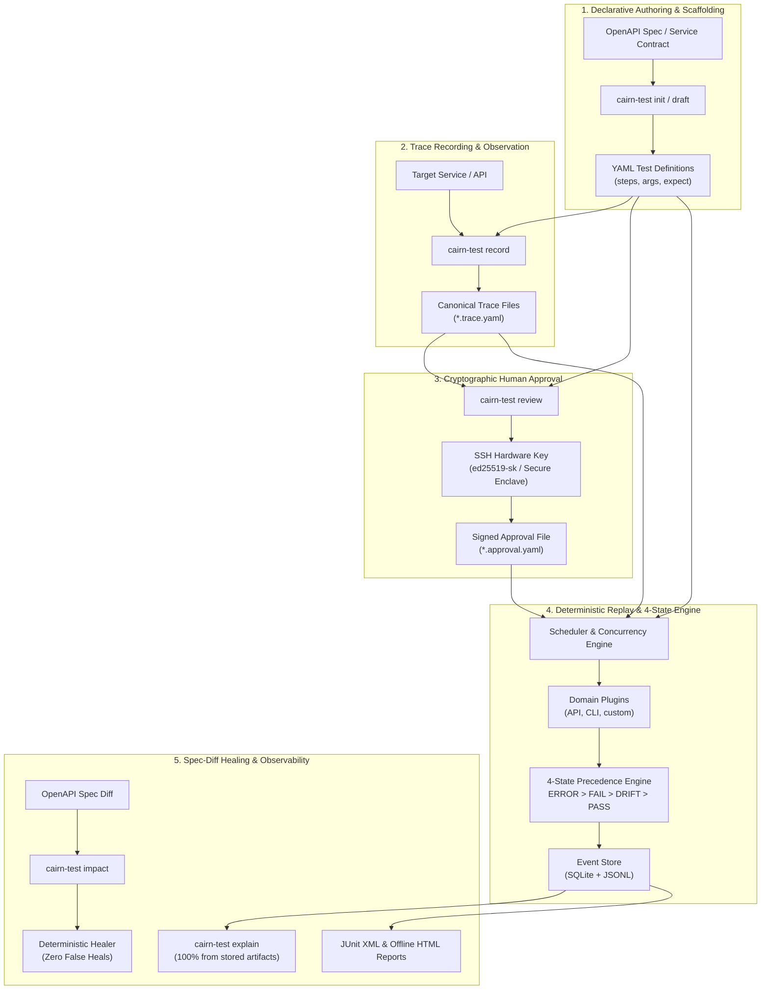

# cairn-test

**A trace-based, domain-neutral test framework for the AI era.**

[](LICENSE)
[](https://www.python.org/)
[](docs/comparison_report.md)

In the AI era, coding agents can generate code and tests in seconds, but they also introduce subtle regressions, hallucinate fake data, and "fix" failing tests by simply weakening assertions. At the same time, microservice teams are plagued by alert fatigue whenever an API contract changes.

`cairn-test` rethinks testing from first principles:
1. **Tests are declarative data**, not fragile harness code.
2. **Recorded traces capture reality**, separating behavioral bugs (**`FAIL`**) from contract changes (**`DRIFT`**) and benign additions (**`PASS`**).
3. **Approvals are cryptographic**: only human hardware keys (`ed25519-sk` / Secure Enclave) sign off on canonical file hashes. Untrusted coding agents cannot approve their own changes.
4. **Healing is strictly deterministic**: it refuses to touch expectations, refuses to invent synthetic data values, and guarantees **zero false heals**.

---

## Architecture Overview



---

## Core Pillars

### 1. The 4-State Outcome Engine (`ERROR > FAIL > DRIFT > PASS`)
Traditional frameworks return a binary `PASS` or `FAIL`. When an endpoint path changes from `/orders` to `/v2/orders`, 50 tests turn red, causing alert fatigue.

`cairn-test` evaluates every test against its recorded trace and OpenAPI spec:
* **`PASS`**: Step execution and all expectations hold true. Benign additive changes (e.g., new optional fields) pass with an additive note.
* **`DRIFT`**: The API contract changed (e.g., parameter moved query $\to$ body, endpoint path changed, field renamed, or required input added), but no behavioral regression occurred.
* **`FAIL`**: A behavioral defect occurred (e.g., wrong calculation, validation regression, authorization bypass).
* **`ERROR`**: Transport/network failure or harness crash.

**Compound Precedence**: If a test encounters both contract drift and a behavioral bug (`CMP-1`), the engine applies normative precedence: `FAIL` is emitted with the contract drift attached as detail. Defects are never masked.

### 2. Cryptographic Human Trust Root
AI coding agents are untrusted actors. In strict CI mode:
* Every test, trace, and local plugin is locked by canonical LF SHA-256 hashes (`covers`).
* Approvals are signed using OpenSSH signature format (`ssh-keygen -Y sign`) using a human hardware security key (`ed25519-sk` or macOS Secure Enclave).
* If an agent tampers with a test file, edits an assertion, alters a trace, or modifies the approval metadata, `cairn-test verify` immediately aborts the run with actionable reason codes.

### 3. Deterministic Spec-Diff Healing
* **Healable Fields Only**: The healer only rewrites request coordinates (`operation`, `method`, `path`, `params` placement).
* **Hard Refusal Limits**: The engine mathematically refuses to modify test expectations, refuses to invent synthetic data values, and refuses to touch `FAIL`s.
* **Unambiguous Suggestions**: Response field renames (`total` $\to$ `grand_total`) produce JSONPath rewrite suggestions with dry-run verification.
* **Value Requests**: New required inputs generate a `value_request` proposal requiring explicit human input; synthetic placeholder values are prohibited.

### 4. Domain-Neutral & Standard-Library-First (NFR-8)
* The core engine (`cairn_test.core`) has **zero dependencies on HTTP, browser, or model libraries**.
* Built with Python 3.12 standard library first (`urllib.request`, `sqlite3`, `xml.etree.ElementTree`, `hashlib`).
* Completely extensible: the CLI step plugin (`cairn_test.plugins.cli`) executes external processes using the exact same contracts with zero core changes.

---

## Quickstart (5 Minutes)

### Installation
Ensure Python 3.12+ and `uv` are installed:
```bash
git clone https://github.com/your-org/cairn-test.git
cd cairn-test
uv pip install -e .
```

### 1. Initialize a Project
Scaffold a new project from your OpenAPI specification:
```bash
cairn-test init --spec path/to/openapi.yaml
```

### 2. Write a Declarative YAML Test
Create `tests/get-product.test.yaml`:
```yaml
schema: cairn-test.test/v1
id: get-product-details
tags:
  - products
  - smoke
steps:
  - id: fetch_prod
    op: getProduct
    args:
      id: prod-1
expect:
  - after: fetch_prod
    status: 200
  - after: fetch_prod
    jsonpath: $.id
    equals: prod-1
  - after: fetch_prod
    jsonpath: $.price
    equals: 99.0
```

### 3. Record Baseline Observations
Execute against your live target service to record baseline traces as inert proposals:
```bash
cairn-test record tests/get-product.test.yaml
```

### 4. Review and Sign Approval
Review the recorded trace and sign approval with your SSH key:
```bash
# Review proposal diff
cairn-test review

# Sign approval with your SSH key
cairn-test approve get-product-details --key ~/.ssh/id_ed25519_sk
```

### 5. Run the Suite
Run in development or strict mode:
```bash
# Run in dev mode
cairn-test run

# Run in strict mode (enforces cryptographic verification)
cairn-test run --strict
```

---

## CLI Command Reference

| Command | Description | Example |
| :--- | :--- | :--- |
| `init` | Scaffold project structure from an OpenAPI spec | `cairn-test init --spec openapi.yaml` |
| `draft` | Deterministically draft baseline tests from spec operations (`--tests`, `--promote`) | `cairn-test draft --spec openapi.yaml --tests` |
| `record` | Record live response observations into trace proposals | `cairn-test record tests/order.test.yaml` |
| `review` | Inspect pending proposals and approved file diffs | `cairn-test review` |
| `approve` | Sign cryptographic approval using an OpenSSH key | `cairn-test approve test-id --key ~/.ssh/id_ed25519_sk` |
| `verify` | Verify signatures and canonical LF hashes in strict mode | `cairn-test verify --strict` |
| `run` | Execute test suite (`--strict`, `--changed`, `--parallel`) | `cairn-test run --strict --parallel 4` |
| `impact` | Analyze blast radius of OpenAPI spec changes | `cairn-test impact --spec-diff diff.yaml` |
| `heal` | Generate deterministic heal proposals for breaking spec diffs | `cairn-test heal --spec-diff diff.yaml` |
| `accept-observations` | Batch-accept additive schema changes into traces | `cairn-test accept-observations` |
| `explain` | Reconstruct test outcome and reason from stored artifacts | `cairn-test explain <run-id> <test-id>` |
| `report` | Generate self-contained HTML or JUnit XML reports | `cairn-test report --run-id <id> --format html` |
| `doctor` | Security and system diagnostic utility | `cairn-test doctor` |
| `status` | View suite health metrics, flakiness, and drift rate | `cairn-test status` |
| `migrate` | Upgrade stored test/trace files across schema versions | `cairn-test migrate --target-version 2` |

---

## Benchmark Highlights (Checkpoint E2)

Evaluated across N=30 behaviors against a stateful reference store API over 3 independent iterations (1,890 total evaluations) vs an LLM-assisted Newman/Postman baseline:

* **Classification Accuracy**: **100.0%** (1,890 / 1,890 evaluations matched expected labels).
* **Triage Time**: **95.83% lower** than Newman (median 1.0s vs 24.0s).
* **Total Maintenance Time to Green**: **94.37% lower** than Newman (median 4.0s vs 71.0s).
* **False Heals**: **0** (strictly verified; defects are never converted to pass).
* **Masking Suggestions**: **0**.
* **Replay Overhead**: **~0.9 ms** per step execution.

Full details in the [Checkpoint E2 Comparison Report](docs/comparison_report.md).

---

## Detailed Documentation

* [Enterprise & Multi-Developer Guide](docs/enterprise-guide.md): Multi-developer workflows, distributed SSH cryptographic signing, zero-secret remote CI/CD pipelines, containerization, and cross-team contract drift management.
* [How-To Guide & Recipes](docs/how-to-guide.md): Complete step-by-step tutorial, YAML patterns (auth, chains, CEL property assertions, fixtures, CLI steps), and CI integration.
* [Core Vision & Philosophy](docs/core-vision.md): Why testing must change in the AI era.
* [Architecture & Specification](docs/plan.md): Normative specification, schemas, decision tables, and healing algorithms.
* [Comparison & Benchmark Report](docs/comparison_report.md): Formal evaluation, audit of Acceptance Criteria 1–9, and honest accounting of where `cairn-test` wins, ties, and loses.
