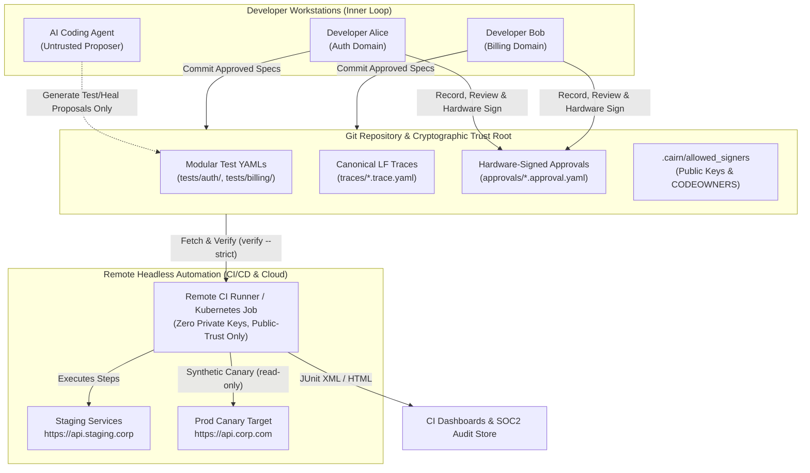

# Enterprise & Multi-Developer Guide

This guide details how `cairn-test` is deployed, governed, and executed in an enterprise setting with multiple developers, cross-functional teams, microservices, and automated remote CI/CD pipelines.

---

## 1. Enterprise Architecture Overview

Modern enterprise test automation struggles with four core problems:
1. **Merge Conflicts**: Monolithic test collections (e.g. Postman JSON or giant Java test suites) cause constant Git conflicts across developers.
2. **Assertion Tampering & AI Risks**: Developers, contractors, or AI coding agents can silently weaken assertions (`expect(status).toBeOneOf([200, 400, 500])`) to make broken pipelines pass.
3. **Alert Fatigue**: When an upstream microservice changes an API route or schema, hundreds of downstream integration tests break, waking up on-call engineers for benign contract drift.
4. **Credential Sprawl**: Remote CI runners frequently hold excessive credentials or unmasked tokens that end up leaked in test logs.



---

## 2. Distributed Team Workflows & Zero Merge Conflicts

### Modular Test Organization by Domain
`cairn-test` structures tests as small, modular YAML files rather than monolithic collection files. Each domain or microservice team owns their subdirectory:

```text
my-enterprise-repo/
├── cairn.yaml                   # Global project config & environment profiles
├── .cairn/
│   └── allowed_signers          # Authorized developer public keys
├── specs/
│   ├── auth-service.yaml        # Service OpenAPI contracts
│   └── billing-service.yaml
├── tests/
│   ├── auth/                    # Auth team tests
│   │   ├── login.test.yaml
│   │   └── token_refresh.test.yaml
│   └── billing/                 # Billing team tests
│       ├── invoice_create.test.yaml
│       └── refund.test.yaml
├── traces/
│   ├── auth/
│   └── billing/
└── approvals/
    ├── auth.approval.yaml       # Domain-scoped cryptographic approval
    └── billing.approval.yaml
```

### Conflict-Free Parallel Development
- **Independent Scopes**: Alice modifies `tests/auth/login.test.yaml` and signs `approvals/auth.approval.yaml`. Bob concurrently creates `tests/billing/refund.test.yaml` and signs `approvals/billing.approval.yaml`.
- **Clean Git Diffs**: Because YAML files are granular and approvals use canonical LF SHA-256 hashes per test ID, Git merges cleanly without merge collisions.

---

## 3. Cryptographic Governance & AI Agent Safety

In `cairn-test`, **the human is the ultimate trust root; AI coding agents and automated PR generators are untrusted proposers.**

### The Distributed Trust Root (`allowed_signers`)
Authorized test authors and QA engineers have their SSH public keys recorded in `.cairn/allowed_signers`:
```text
alice@company.com sk-ssh-ed25519@openssh.com AAAAGnNrLXNza... alice-yubikey
bob@company.com   sk-ssh-ed25519@openssh.com AAAAGnNrLXNza... bob-touchid
lead-qa@corp.com  ssh-ed25519 AAAAC3NzaC1lZDI1NTE5...      qa-signing-key
```

### Git Branch Protection & CODEOWNERS
To enforce governance across teams, protect `.cairn/allowed_signers` and `approvals/` via repository rules:
```text
# .github/CODEOWNERS
.cairn/allowed_signers     @enterprise/security-team @enterprise/qa-leads
approvals/auth.*           @enterprise/auth-team
approvals/billing.*        @enterprise/billing-team
```

### AI Agent Isolation
1. **AI Proposes**: When an AI agent (e.g. Cursor, Copilot, Antigravity) generates a new test or auto-heals an API route drift, it creates a test proposal (`*.proposal.yaml`).
2. **AI Cannot Approve**: The AI does not possess a physical hardware key (`ed25519-sk`). It cannot forge an approval signature.
3. **Human Signs**: The developer reviews the diff using `cairn-test review` and signs with their hardware key (`cairn-test approve <test-id>`).
4. **CI Enforcement**: If an agent attempts to edit test expectations without human signoff, remote CI fails immediately with `UNAPPROVED_FILE` or `HASH_MISMATCH`.

---

## 4. Remote Headless Automation & CI/CD Pipelines

`cairn-test` is built for headless, remote execution.

### Asymmetric Security: Zero Secrets on Remote Runners
A primary vulnerability in traditional CI setups is placing signing credentials or private keys onto remote CI runners.
* **`cairn-test` requires NO private keys on remote runners.**
* Remote servers only need the public trust root (`.cairn/allowed_signers`).
* The remote runner runs:
  ```bash
  cairn-test verify && cairn-test run --strict
  ```
* If any test file or trace was tampered with in transit or on the runner, verification fails instantly.

### Deterministic POSIX Exit Codes
Automated pipelines branch deterministically based on standard exit codes:

| Exit Code | Outcome | Meaning in CI/CD Pipeline | Recommended Action |
| :---: | :--- | :--- | :--- |
| **`0`** | `PASS` | All tests and expectations verified | Promote build / continue pipeline |
| **`1`** | `FAIL` | Behavioral defect detected in target API | Block PR; alert code authors |
| **`2`** | `DRIFT` | API contract drifted; no bug found | Flag PR; trigger auto-heal workflow |
| **`3`** | `ERROR` | Verification failed, tamper detected, crash | Block PR; trigger security alert |

### Production GitHub Actions Workflow
```yaml
# .github/workflows/cairn-ci.yml
name: Cairn Test CI
on:
  push:
    branches: [main]
  pull_request:

jobs:
  test:
    runs-on: ubuntu-latest
    steps:
      - uses: actions/checkout@v4
      - uses: astral-sh/setup-uv@v2
        with:
          version: "latest"

      - name: Install cairn-test
        run: uv pip install -e .

      # Step 1: Strict Verification against committed public keys
      - name: Verify Cryptographic Signatures
        run: uv run cairn-test verify --strict
        env:
          CAIRN_ALLOWED_SIGNERS: .cairn/allowed_signers

      # Step 2: Headless Execution against PR Preview or Staging
      - name: Run Test Suite
        id: run_suite
        run: |
          uv run cairn-test run --strict \
            --base-url "https://preview-${{ github.event.pull_request.number }}.corp.net" \
            --concurrency 4 \
            --junit junit-report.xml \
            --html cairn-report.html
        env:
          API_BEARER_TOKEN: ${{ secrets.STAGING_API_TOKEN }}

      # Step 3: Publish JUnit & HTML Test Reports
      - name: Publish Test Dashboard
        uses: actions/upload-artifact@v4
        if: always()
        with:
          name: test-reports
          path: |
            junit-report.xml
            cairn-report.html
```

---

## 5. Environment Profiles & Secrets Governance

### Zero-Config Multi-Environment Targeting (`cairn.yaml`)
Target endpoints change across development, staging, preview, and production environments:

```yaml
# cairn.yaml
version: "cairn.v1"
default_env: "local"

env_profiles:
  local:
    base_url: "http://localhost:8080"
  dev:
    base_url: "https://api.dev.corp.net"
  staging:
    base_url: "https://api.staging.corp.net"
  preview:
    base_url: "${PREVIEW_URL}"
  prod:
    base_url: "https://api.corp.com"
```

To switch targets:
```bash
cairn-test run --env staging
# Or dynamically override:
cairn-test run --base-url "https://custom-service.internal"
```

### Secrets Injection & Zero-Leak Masking (NFR-5)
1. **Never Commit Secrets**: Secrets are referenced via runtime environment variable interpolation:
   ```yaml
   steps:
     - id: authorize_order
       op: postOrder
       args:
         headers:
           Authorization: "Bearer ${CORP_API_TOKEN}"
           X-Signature: "${HMAC_SECRET}"
   ```
2. **Automated Evidence Masking**: When `cairn-test` records traces or outputs logs and reports, all sensitive tokens, cookies, passwords, and authorization headers are automatically redacted to `[MASKED]` before writing to disk. Secrets never enter Git or test artifacts.

---

## 6. Microservices & Cross-Team Contract Drift

In a microservice mesh, upstream teams (e.g. Billing) update their endpoints or schemas, impacting downstream teams (e.g. Checkout).

```text
[Billing Team] ──Publishes──> billing-v2.yaml
                                      │
                                      ▼
                             [Checkout Team CI]
                        cairn-test impact --spec-diff
                                      │
                   ┌──────────────────┴──────────────────┐
                   ▼                                     ▼
     4 Affected Tests Identified           Unchanged Tests Skipped
                   │
                   ▼
       cairn-test heal --spec-diff
                   │
                   ▼
   Generates .proposal.yaml diffs
 (Path updates, query->body moves)
                   │
                   ▼
    Developer Reviews & Signs Off
```

1. **Selective Blast Radius (`impact`)**:
   Instead of running thousands of tests, the downstream team runs:
   ```bash
   cairn-test impact --spec-diff specs/billing-v2.yaml
   ```
   `cairn-test` returns only the exact subset of tests that touch the modified operations.
2. **Deterministic Healing (`heal`)**:
   Running:
   ```bash
   cairn-test heal --spec-diff specs/billing-v2.yaml
   ```
   analyzes the spec diff and generates proposals updating operation coordinates and parameters. It **refuses** to touch expectations or invent synthetic data values.
3. **Fast Triage**: Downstream teams repair their test suite in seconds, with zero false heals.

---

## 7. Production Synthetic Canaries & Observability

`cairn-test` can run in production environments as an automated synthetic canary:

### Kubernetes CronJob Example
```yaml
apiVersion: batch/v1
kind: CronJob
metadata:
  name: cairn-prod-canary
spec:
  schedule: "*/5 * * * *"   # Every 5 minutes
  concurrencyPolicy: Forbid
  jobTemplate:
    spec:
      template:
        spec:
          containers:
          - name: canary
            image: ghcr.io/your-corp/cairn-test:latest
            command: ["cairn-test", "run", "--strict", "--tags", "canary", "--env", "prod"]
            env:
            - name: CAIRN_ALLOWED_SIGNERS
              valueFrom:
                configMapKeyRef:
                  name: cairn-config
                  key: allowed_signers
            - name: CORP_CANARY_TOKEN
              valueFrom:
                secretKeyRef:
                  name: cairn-secrets
                  key: canary_token
          restartPolicy: Never
```

### Alerting Strategy
- **Exit Code 1 (`FAIL`)**: Direct pager alert to on-call engineer (behavioral outage or service bug).
- **Exit Code 2 (`DRIFT`)**: Slack notification to API Platform team (endpoint contract updated).
- **Exit Code 0 (`PASS`)**: Metric incremented in Prometheus / Datadog.

---

## 8. Summary Comparison

| Dimension | Legacy Tools (Postman/Newman, RestAssured) | `cairn-test` in Enterprise |
| :--- | :--- | :--- |
| **Git Collaboration** | Monolithic JSON/code files with constant merge conflicts | Modular YAML per domain; zero merge conflicts |
| **Security & Provenance** | Anyone or any script can edit assertions undetected | Human hardware cryptographic approvals (`ed25519-sk`) |
| **Remote CI Trust** | CI runners hold full write/sign privileges | Zero-secret runners; verify using public keys only |
| **Contract Changes** | Binary failure; hundreds of broken tests cause alert fatigue | 4-state engine separates `DRIFT` from `FAIL`; deterministic healing |
| **Secrets Safety** | Risk of tokens committed to collections or unmasked logs | Runtime env interpolation and automated masking (`[MASKED]`) |
| **Audit Readiness** | Ad-hoc test reports without cryptographic verification | Immutable SQLite run logs + signed SHA-256 coverage maps |
